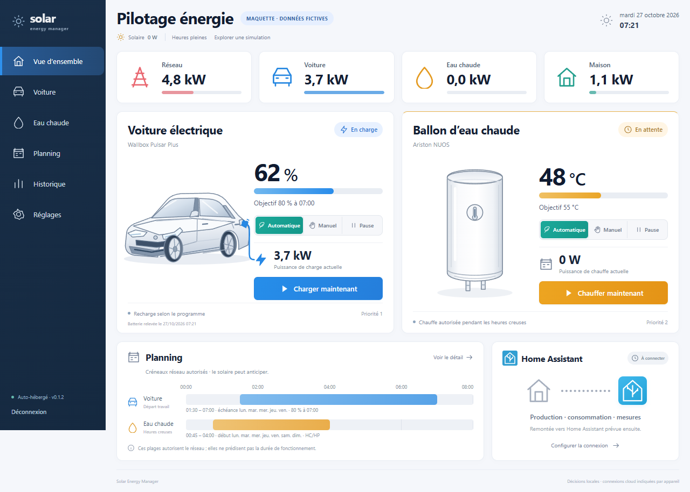

# Solar Energy Manager

Gestionnaire d’énergie indépendant et auto-hébergé pour piloter une recharge de voiture électrique et un ballon d’eau chaude selon le surplus solaire et les horaires souhaités.

## État du projet

Première version à mettre en service : application, interface et tests automatisés développés. Les comptes et appareils réels restent à vérifier avant activation. L’état exact du conteneur et de sa publication est indiqué dans le guide de distribution. Voir le [compte rendu de validation](docs/deployment/acceptance-report.md).

- [Conception validée](docs/superpowers/specs/2026-10-26-solar-energy-manager-design.md)
- [Plan de développement V1](docs/superpowers/plans/2026-10-26-solar-energy-manager-v1.md)
- [Distribution privée GitHub, GHCR et Portainer](docs/deployment/github-portainer.md)

## Fonctions de la première version

- Application web en français, utilisable sur ordinateur et téléphone.
- Bornes OCPP 1.6J, avec une première Wallbox Pulsar Plus et plusieurs bornes enregistrables.
- Données de batterie de la Peugeot e-208 de 2020 récupérées auprès des services Peugeot.
- Pilotage natif du ballon Ariston NUOS Plus Wi-Fi, selon ses capacités réellement vérifiées.
- Mesures de production et d’échanges réseau issues de Home Assistant.
- Répartition du surplus solaire, priorités configurables et gestion réglable des passages de nuages.
- Programmes récurrents de recharge et plages HC/HP saisies dans l’application.
- Image Docker privée publiée sur GitHub Container Registry et fichier Compose pour une Stack Portainer.

Après fonctionnement de la base : intégration de remontée vers Home Assistant, puis gestion EDF Tempo.

## Aperçus

Les données, horaires et priorités illustrés sont fictifs et modifiables. Ces images ne prouvent aucune connexion matérielle.

Interface 0.1.2, corrigée pour reprendre la composition du concept initial :



[Version mobile](docs/assets/dashboard-0.1.2-mobile.png) · [Concept de référence](docs/assets/pilotage-energie-concept-v1.png) · [Revue et vérifications de la correction](docs/development-review-ui-0.1.2.md)

## Sources et dépendances

FastAPI, React/TypeScript, SQLite, bibliothèques `ocpp` et `ariston`. Les connecteurs produisent des mesures normalisées ; le moteur décide ; le coordinateur sérialise les commandes et conserve les réservations jusqu’à réconciliation. Les appels cloud s’exécutent en arrière-plan. Les adaptations ciblées d’EVCC et leur licence MIT sont identifiées dans [la provenance Peugeot](docs/third-party/peugeot-provenance.md). Ce projet possède son propre service et son interface.

Les comptes connectés, identifiants, jetons et données d’exploitation ne doivent pas être versionnés. Le dépôt et le paquet GHCR doivent rester privés.

## Installation Portainer

Utiliser [compose.yaml](compose.yaml) dans une Stack, après ajout du registre privé GHCR. Suivre le [guide Portainer](docs/deployment/portainer.md). Le port 8080 dessert le web et `/ocpp/IDENTIFIANT_BORNE`.

Au premier démarrage, lire `/data/bootstrap-token` dans la console du conteneur et créer le compte administrateur dans l’interface. Configurer les mesures et les appareils, tester les connexions, vérifier les capacités et le repli hors ligne, puis activer chaque appareil séparément. Les valeurs indisponibles restent inconnues. Le mode manuel est temporaire et propre à chaque appareil ; la démonstration ne commande aucun appareil.

Guides : [Wallbox](docs/deployment/wallbox-commissioning.md), [Peugeot](docs/deployment/peugeot-connection.md), [Ariston](docs/deployment/ariston-commissioning.md), [sauvegarde et restauration](docs/deployment/backup-restore.md).

## Développement et vérifications

Python 3.12 et Node.js 24.11.1. Installer les dépendances de `backend/requirements.lock` dans un environnement Python dédié, puis :

```sh
python -m pytest -q
npm --prefix frontend ci
npm --prefix frontend test
npm --prefix frontend run build
python scripts/export_openapi.py
npm --prefix frontend run types
```

Pour le parcours navigateur : installer Chromium avec `npx playwright install chromium` depuis `frontend`, puis `npm run e2e`. Le test lance une API temporaire sans connecteurs actifs. `SEM_PYTHON` peut préciser l’interpréteur, `SEM_BROWSER` un navigateur Chromium local et `SEM_SCREENSHOT_DIR` le dossier des captures. Le smoke test Docker s’exécute en CI avec `SEM_TEST_IMAGE=sem:test` après construction.

Pour démarrer le service local après compilation, définir `SEM_DATA_DIR` vers un répertoire de travail dédié :

```sh
uvicorn app.main:create_app --factory --app-dir backend --host 127.0.0.1 --port 8080
```

Une seule instance de contrôle par volume est autorisée. La V1 vise Linux amd64. Les limites par phase et le comportement hors ligne doivent être vérifiés sur l’installation avant activation.
