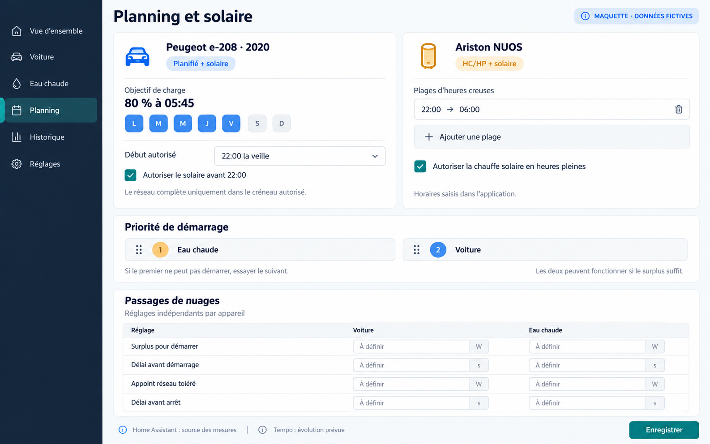

# Solar Energy Manager

Gestionnaire d’énergie indépendant et auto-hébergé pour piloter une recharge de voiture électrique et un ballon d’eau chaude selon le surplus solaire et les horaires souhaités.

## État du projet

La conception a été validée le 26 octobre 2026. Le plan d’implémentation est rédigé et soumis à revue. Ce premier dépôt contient les documents et les maquettes ; il ne contient pas encore une application fonctionnelle ni une image Docker publiée.

- [Conception validée](docs/superpowers/specs/2026-10-26-solar-energy-manager-design.md)
- [Plan de développement V1](docs/superpowers/plans/2026-10-26-solar-energy-manager-v1.md)
- [Distribution privée GitHub, GHCR et Portainer](docs/deployment/github-portainer.md)

## Cible de la première version

- Application web en français, utilisable sur ordinateur et téléphone.
- Bornes OCPP 1.6J, avec une première Wallbox Pulsar Plus et plusieurs bornes enregistrables.
- Données de batterie de la Peugeot e-208 de 2020 récupérées auprès des services Peugeot.
- Pilotage natif du ballon Ariston NUOS Plus Wi-Fi, selon ses capacités réellement vérifiées.
- Mesures de production et d’échanges réseau issues de Home Assistant.
- Répartition du surplus solaire, priorités configurables et gestion réglable des passages de nuages.
- Programmes récurrents de recharge et plages HC/HP saisies dans l’application.
- Image Docker privée publiée sur GitHub Container Registry et fichier Compose pour une Stack Portainer.

Après fonctionnement de la base : intégration de remontée vers Home Assistant, puis gestion EDF Tempo.

## Aperçus

Les données, horaires et priorités illustrés sont fictifs et modifiables. Ces images ne prouvent aucune connexion matérielle.

[Première vue d’ensemble](docs/assets/pilotage-energie-concept-v1.png)

## Sources et dépendances

Le projet est indépendant d’EVCC. La réutilisation éventuelle de modules EVCC ou d’autres bibliothèques sera ciblée, documentée et conforme à leurs licences. Aucun code EVCC n’a été copié dans ce premier dépôt documentaire.

Les comptes connectés, identifiants, jetons et données d’exploitation ne doivent pas être versionnés. Le dépôt et le paquet GHCR doivent rester privés.
