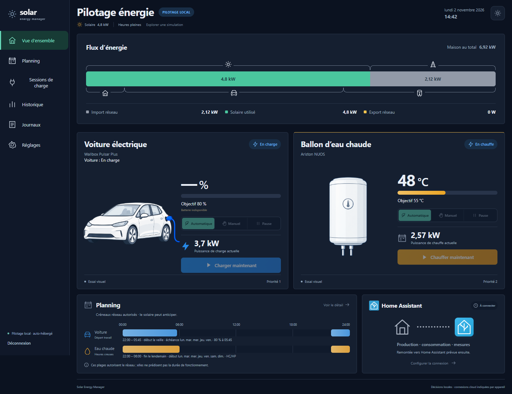
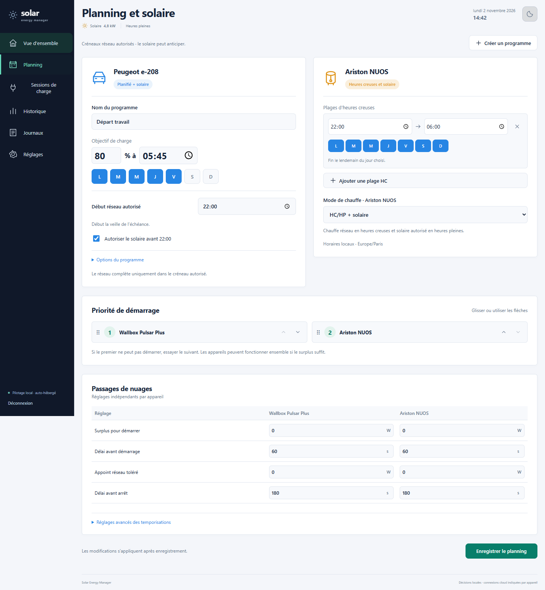
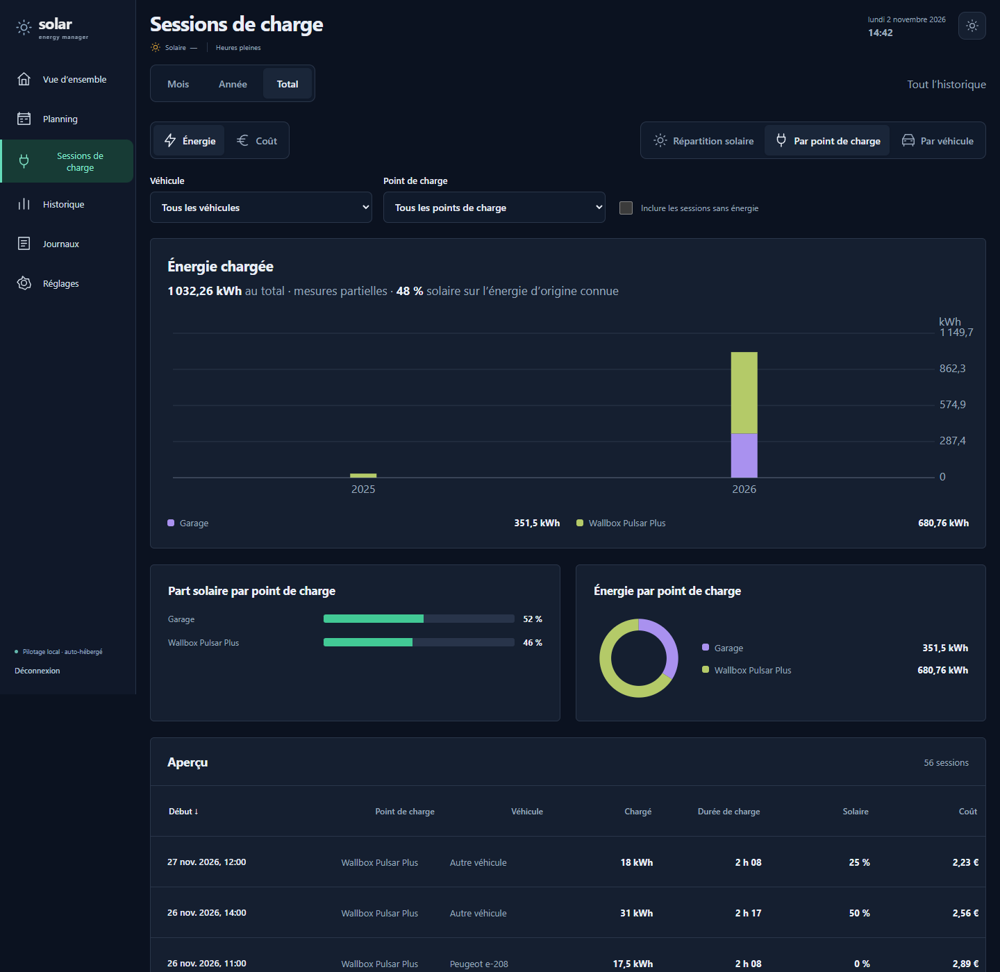
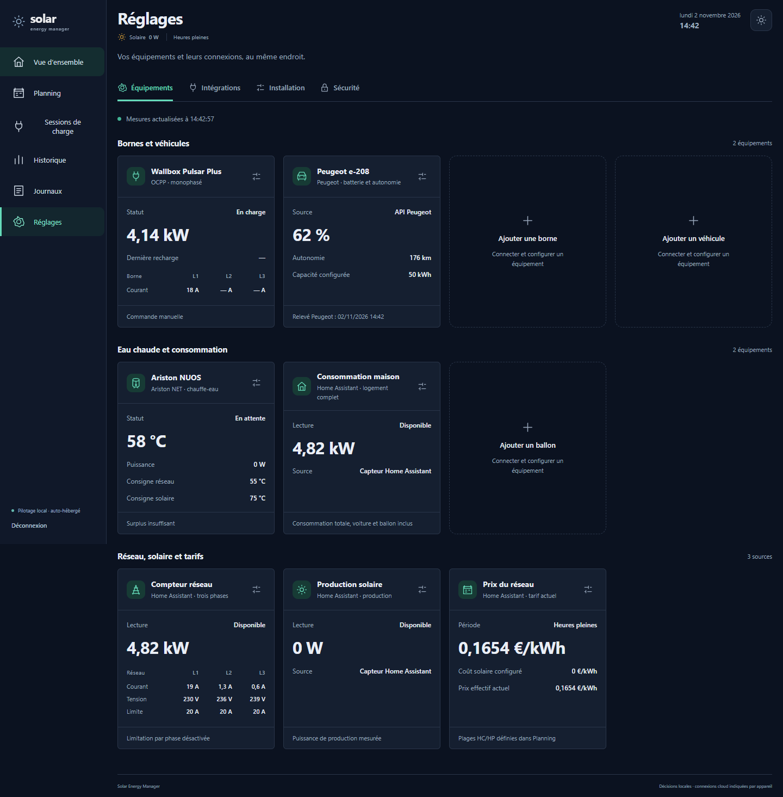
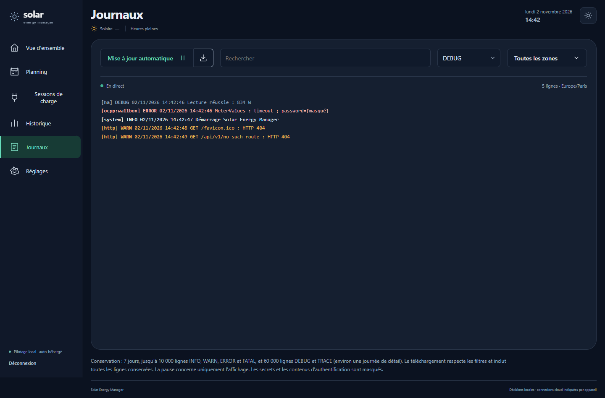
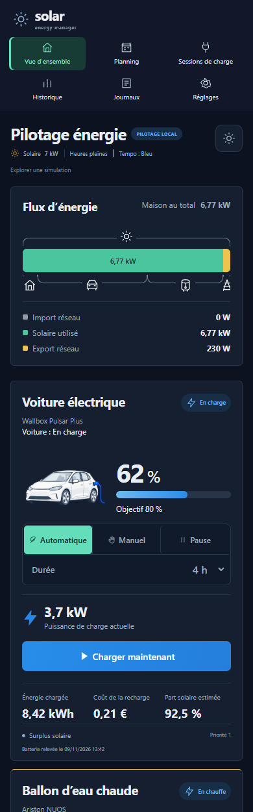

# Solar Energy Manager

Gestionnaire d’énergie auto-hébergé qui pilote la recharge d’une voiture électrique et un ballon d’eau chaude selon le surplus solaire, les heures creuses et les programmes choisis. SEM décide localement et commande directement la borne et le ballon. Home Assistant lui fournit les mesures et reçoit en retour ses calculs.

**Version actuelle : 0.1.41** · image privée `ghcr.io/macorou/solar-energy-manager` · déploiement Docker / Portainer



> Les captures de cette page sont produites par les tests de l’interface, avec des données fictives. Elles ne montrent aucune installation réelle.

## Ce que fait SEM

**Recharge de la voiture**
- Pilote une borne **OCPP 1.6J** (Wallbox Pulsar Plus en service, autres bornes enregistrables).
- Régulation du courant adaptée d’EVCC : pas de 0,1 A, limites par phase, réduction immédiate en cas de surcharge, temporisations pour les passages de nuages.
- Modes **Automatique**, **Manuel** et **Pause**. Le Manuel dure de 1 h à 12 h au choix et repasse en Automatique à la fin de la durée ou au débranchement.
- Programmes récurrents : objectif en % à une heure donnée, jours de la semaine, début du créneau réseau autorisé.
- **Objectif sur surplus** : au-delà de l’objectif, la voiture continue de charger avec le seul surplus solaire.
- Batterie lue auprès de Peugeot, puis estimée pendant la session à partir de l’énergie chargée.
- Courant de secours réglable quand la mesure réseau manque.

**Ballon d’eau chaude**
- Pilotage natif d’un **Ariston NUOS Plus Wi-Fi** : arrêt, solaire, heures creuses + solaire.
- Consignes de température distinctes pour le réseau et pour le solaire.
- Manuel et « Chauffer maintenant » de 30 min à 4 h au choix, confirmation croisée Ariston / Home Assistant.

**Partage du surplus**
- Priorités de démarrage entre appareils, réglables par glisser-déposer.
- Réglages par appareil pour les passages de nuages : surplus pour démarrer, délais, appoint réseau toléré.
- Plages d’heures creuses et prix du réseau, avec le prix effectif de l’énergie consommée.
- **Jours rouges EDF Tempo** (couleur lue dans Home Assistant) : aucun courant réseau en automatique pendant les heures pleines, surplus solaire seul, Manuel possible après confirmation. Voir la [note 0.1.34](docs/deployment/patch-0.1.34.md).

**Suivi**
- **Sessions de charge** : historique persistant, vues mois / année / total, énergie, coût et part solaire, filtres, exports CSV et Excel.
- **Historique** des décisions et des commandes, avec leurs confirmations.
- **Journaux** de communication (OCPP, Home Assistant, Peugeot, Ariston, moteur) : direct, recherche, niveaux, zones et téléchargement. Les secrets sont masqués avant l’enregistrement.

**Home Assistant**
- Lecture des mesures : compteur réseau (trois phases), production solaire, consommation de la maison, prix.
- Publication par **MQTT avec découverte automatique** : prix instantané de l’énergie (site, voiture, ballon), surplus, batterie, puissances, états, raisons, sessions. Voir la [note 0.1.28](docs/deployment/patch-0.1.28.md).
- Commandes facultatives depuis Home Assistant (désactivées par défaut) : mode de la voiture et objectif de chaque programme. Voir la [note 0.1.31](docs/deployment/patch-0.1.31.md).

**Interface et accès**
- Application web en français, thèmes sombre et clair, adaptée au téléphone (iPhone / Safari compris).
- Compte administrateur unique, connexion maintenue 30 jours après la dernière visite.
- Réglages → Sécurité : liste des appareils connectés et déconnexion à distance.

## Aperçu

| Planning | Sessions de charge |
|---|---|
|  |  |

| Réglages | Journaux | Téléphone |
|---|---|---|
|  |  |  |

## Matériel et services

| Élément | Prise en charge |
|---|---|
| Borne | OCPP 1.6J, en WebSocket sur le même port que l’interface (`/ocpp/IDENTIFIANT_BORNE`). Validée sur Wallbox Pulsar Plus. |
| Voiture | Peugeot e-208 (2020) : batterie et autonomie lues sur les services Peugeot. Une autre voiture charge sans pourcentage de batterie. |
| Ballon | Ariston NUOS Plus Wi-Fi, par le cloud Ariston NET. |
| Mesures | Capteurs Home Assistant : réseau par phase, production solaire, consommation de la maison. |
| Publication | Courtier MQTT (Mosquitto, par exemple) avec découverte Home Assistant. |
| Serveur | Docker Linux amd64, un seul conteneur, données dans un volume. |

Les fonctions EVCC qui n’ont pas été reprises (bascule automatique mono/triphasé, autres protocoles de borne) ne sont pas prises en charge.

## Installation

1. Dans Portainer, ajouter le registre privé `ghcr.io` avec un jeton GitHub autorisé en lecture sur le paquet (`read:packages`).
2. Créer une Stack à partir de [compose.yaml](compose.yaml). Variables facultatives : `SEM_VERSION`, `SEM_HTTP_PORT` (8080 par défaut), `SEM_PUBLIC_URL`, `SEM_SECURE_COOKIE` (`true` derrière HTTPS).
3. Ouvrir `http://IP_DU_SERVEUR:8080`. Lire le code de première connexion avec `cat /data/bootstrap-token` dans la console du conteneur, puis créer le mot de passe administrateur.
4. Dans Réglages, renseigner la limite électrique, les capteurs Home Assistant, puis la borne, la voiture et le ballon. Tester chaque connexion avant d’activer l’appareil.

Le détail est dans le [guide Portainer](docs/deployment/portainer.md), avec la mise en service de la [Wallbox](docs/deployment/wallbox-commissioning.md), du compte [Peugeot](docs/deployment/peugeot-connection.md) et du ballon [Ariston](docs/deployment/ariston-commissioning.md).

## Mise à jour

Changer `SEM_VERSION` dans la Stack, puis la mettre à jour en téléchargeant l’image. Le volume de données est conservé. Chaque version a sa note dans [docs/deployment](docs/deployment/) (`patch-0.1.X.md`). Elle précise s’il faut sauvegarder le volume avant la mise à jour et comment revenir en arrière. La procédure de sauvegarde est décrite dans [sauvegarde et restauration](docs/deployment/backup-restore.md).

## Fonctionnement

Les connecteurs (OCPP, Home Assistant, Peugeot, Ariston) produisent des mesures datées et normalisées. Le moteur répartit la puissance disponible selon les limites, les programmes et les priorités. Le coordinateur envoie les commandes une à une, réserve la puissance demandée jusqu’à la confirmation par une mesure, et consigne chaque décision dans l’historique. Une valeur absente reste inconnue : elle n’est jamais remplacée par zéro.

Backend Python 3.12 (FastAPI, SQLite, bibliothèques `ocpp` et `ariston`), interface React / TypeScript, image Docker publiée sur GitHub Container Registry.

## Sécurité et données

- Le conteneur tourne sans privilège (UID 10001), avec un système de fichiers en lecture seule hors du volume `/data`.
- Les mots de passe et jetons des services (Peugeot, Ariston, MQTT, borne) sont chiffrés dans le volume et ne sont jamais réaffichés ni écrits dans les journaux.
- Le cookie de session est inaccessible aux scripts et n’est pas envoyé depuis un autre site.
- Le dépôt est public, sous licence MIT ; l’image reste privée. Aucun identifiant, jeton ni donnée d’exploitation n’est versionné.

## Développement

Python 3.12 et Node.js 24.11.1. Installer `backend/requirements.lock` dans un environnement Python dédié, puis :

```sh
python -m pytest -q
npm --prefix frontend ci
npm --prefix frontend test
npm --prefix frontend run build
python scripts/export_openapi.py && npm --prefix frontend run types
```

Les tests utilisent un dossier de données jetable (`SEM_DATA_DIR`) et des transports simulés : ils n’envoient aucune commande à un appareil réel.

Tests navigateur : depuis `frontend`, `npx playwright install chromium webkit` puis `npm run e2e`. Ils lancent une API temporaire avec des données fictives. `SEM_PYTHON` choisit l’interpréteur, `SEM_BROWSER` un Chrome local, `SEM_SCREENSHOT_DIR` le dossier des captures.

Service local, après compilation de l’interface :

```sh
SEM_DATA_DIR=./work/data uvicorn app.main:create_app --factory --app-dir backend --host 127.0.0.1 --port 8080
```

Publier une version : pousser un tag `v0.1.X`. Le workflow lance les tests backend, frontend et navigateur, construit l’image, la vérifie, puis la publie sur GHCR.

## Documentation

- [Conception](docs/superpowers/specs/2026-10-26-solar-energy-manager-design.md) et [plans de développement](docs/superpowers/plans/)
- [Sessions de charge](docs/features/charging-sessions.md) · [Journaux](docs/features/journaux.md)
- [Distribution GitHub, GHCR et Portainer](docs/deployment/github-portainer.md) · [Compte rendu de validation](docs/deployment/acceptance-report.md)
- [Recherches sur EVCC](docs/research/)

## Provenance

La régulation de recharge, les profils OCPP et la lecture de batterie Peugeot reprennent du code d’[EVCC](https://github.com/evcc-io/evcc), sous licence MIT. La source utilisée et les adaptations sont décrites dans [la provenance](docs/third-party/peugeot-provenance.md) et la licence est dans [evcc-MIT.txt](docs/third-party/evcc-MIT.txt). SEM a son propre service et sa propre interface ; il ne dépend pas d’une installation EVCC.

## Licence

SEM est distribué sous [licence MIT](LICENSE). Le code repris d’EVCC reste soumis à sa propre licence MIT, reproduite dans [evcc-MIT.txt](docs/third-party/evcc-MIT.txt).
