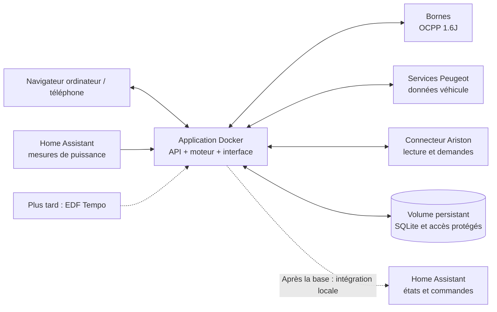

# Gestion d’énergie solaire — document de conception

Date : 26 octobre 2026. Statut : conception validée par Jordan ; ajout de la distribution privée GitHub/GHCR demandé après validation.

Ce document structure un nouveau projet indépendant d’EVCC. Il décrit la cible et les critères de fonctionnement ; il ne signifie pas que les connexions matérielles ont été testées. Les éléments « décidés » proviennent des échanges avec Jordan. Les éléments « proposés » sont des choix de conception soumis à sa validation.

## 1. Intention

Piloter la recharge d’une voiture électrique et la chauffe d’un ballon d’eau chaude depuis une application web auto-hébergée. Utiliser le surplus solaire lorsque c’est possible, respecter les horaires et les besoins configurés, puis ajouter EDF Tempo lorsque la base fonctionne.

L’utilisateur doit comprendre ce que fait chaque appareil et pourquoi : charge solaire, complément planifié, chauffe en heures creuses, attente de puissance, objectif atteint, mesure périmée ou connexion indisponible.

## 2. Décisions acquises

| Sujet | Décision de Jordan |
|---|---|
| Nature du projet | Application indépendante ; bibliothèques existantes et modules EVCC réutilisables si utiles. |
| Hébergement | Docker ; fournir un fichier Compose directement utilisable dans une Stack Portainer. |
| Sources et images | Dépôt GitHub privé ; récupérer l’image du projet depuis GitHub pour le Compose. |
| Interface | Application web. Une première maquette a été présentée. |
| Première borne | Wallbox Pulsar Plus, pilotée en OCPP ; prévoir l’ajout d’autres bornes. |
| Première voiture | Peugeot e-208 de 2020 ; récupérer les données de batterie par les services/API Peugeot. |
| Premier ballon | Ariston NUOS Plus Wi-Fi. |
| Mesures d’énergie | Connecteur Home Assistant pour récupérer les puissances solaire, réseau et autres mesures utiles. |
| Heures creuses | Horaires saisis dans les paramètres ; aucune dépendance à un état HC/HP de Home Assistant. |
| Solaire | Voiture et ballon seuls ou ensemble selon la puissance disponible ; préférence de démarrage configurable. |
| Nuages | Puissances tolérées et durées configurables. |
| Planning voiture | Plusieurs programmations possibles, avec jours, début autorisé, heure limite et objectif en pourcentage. Le solaire peut autoriser la recharge avant le début défini. |
| Exemple de planning | Atteindre 80 % du lundi au vendredi à 5 h 45. |
| Ballon | Chauffe autorisée en heures creuses ou grâce au solaire. |
| Remontées HA | Prévoir une intégration Home Assistant après le fonctionnement de la base. |
| Évolution différée | EDF Tempo : blocages configurables et anticipation selon la couleur du lendemain. |

## 3. Approches étudiées et choix

1. **Compléter ou modifier EVCC.** Réutilisation importante de son fonctionnement et de ses connecteurs, mais dépendance à sa structure pour les écrans et les règles propres au projet.
2. **Construire une application indépendante et modulaire.** Maîtrise de l’interface, des règles et des évolutions ; davantage de code et d’intégrations à maintenir.

Jordan a choisi la seconde approche, avec autorisation de réutiliser des modules EVCC lorsque cela est pertinent. EVCC n’est donc pas un service obligatoire de la Stack et ne prend pas de décisions en parallèle du nouveau moteur.

## 4. Périmètre et ordre de livraison

### Base fonctionnelle — V1

- Interface web en français, utilisable sur ordinateur et téléphone.
- Configuration persistante depuis l’interface.
- Serveur OCPP 1.6J avec plusieurs bornes enregistrables ; validation réelle sur la Pulsar Plus.
- Association d’un véhicule à une borne ; aucune identification automatique du véhicule prétendue sans mécanisme validé.
- Lecture des données Peugeot, avec authentification et renouvellement des accès adaptés au service réellement utilisable.
- Lecture et demandes de fonctionnement au ballon Ariston par un connecteur dédié.
- Lecture des mesures de puissance dans Home Assistant.
- Pilotage solaire, ordre de préférence et gestion configurable des passages de nuages.
- Plannings récurrents de la voiture et plages HC/HP locales pour le ballon.
- Commandes manuelles propres à chaque équipement, historique et diagnostic.
- Simulation clairement identifiable pour vérifier les règles avant utilisation sur les appareils.
- Image Docker et fichier Compose pour Portainer, stockage persistant, sauvegarde et restauration.

La V1 ne sera pas déclarée validée sur l’installation si l’accès Peugeot ou le pilotage du ballon ne fonctionne qu’en simulation. Les difficultés d’un connecteur restent isolées afin de permettre le développement et les tests des autres fonctions.

### Remontées Home Assistant — après la base

Intégration personnalisée utilisant l’API locale du projet, avec configuration de l’adresse et d’un accès dédié. Exposer les appareils, puissances, énergies, modes, objectifs, disponibilités et raisons de décision ; proposer les commandes prévues par l’application. Le connecteur de lecture des mesures HA est déjà inclus dans la V1 et ne dépend pas de cette intégration de retour.

### EDF Tempo — évolution ultérieure

Couleur du jour et du lendemain, périodes tarifaires, politiques de blocage et anticipation dans les créneaux autorisés. Prévoir dès V1 une interface interne de tarifs et de restrictions pour ajouter cette évolution sans réécrire les connecteurs matériels.

### Hors première version

Pas de batterie domestique, V2G, prévision météorologique, accès cloud hébergé par le projet, application mobile native, changement automatique de phases non validé, ni prise en charge revendiquée de toutes les marques. L’architecture autorise des ajouts ultérieurs.

## 5. Architecture proposée

**Choix techniques proposés par Codex, non encore imposés par Jordan :**

- Backend Python avec FastAPI et traitements asynchrones pour les connexions réseau et le moteur.
- Interface TypeScript avec React, compilée et servie par l’application.
- SQLite pour la configuration, les événements, les occurrences de planning et l’historique initial.
- Bibliothèque Python `mobilityhouse/ocpp` comme candidate pour OCPP 1.6J.
- Bibliothèque cliente Ariston existante comme candidate, après vérification des fonctions nécessaires sur le NUOS.
- Connecteur Peugeot isolé, basé sur un accès réellement validé ; étudier les mécanismes existants d’EVCC. Ne pas embarquer automatiquement une autre application complète.
- Un seul service applicatif dans la Stack initiale, un seul processus propriétaire du moteur de commandes et un volume de données. Aucun broker MQTT ou serveur de base de données supplémentaire obligatoire.

Ces choix favorisent un premier déploiement simple et les bibliothèques Python disponibles. Les parties Go d’EVCC ne sont pas directement importables dans Python : une reprise éventuelle sera ciblée et adaptée, ou remplacée par une bibliothèque équivalente. Si l’exploration révèle qu’un service supplémentaire est indispensable, cette modification d’architecture sera expliquée avant son intégration.



Les automatismes tournent côté serveur même lorsque le navigateur est fermé. Le moteur décide ; les connecteurs traduisent et vérifient les échanges. Une panne ou une lenteur cloud ne bloque pas la réception OCPP ou l’interface.

## 6. Organisation prévue du dépôt

Arborescence indicative, à créer après approbation de la conception :

```text
projet/
  backend/
    app/
      api/                  # API locale, authentification, flux d’événements
      domain/               # appareils, mesures, objectifs et capacités
      engine/               # allocation de puissance et décisions
      scheduling/           # récurrences, échéances et fuseaux horaires
      tariffs/              # HC/HP locales ; extension Tempo
      connectors/
        ocpp/               # bornes et connecteurs de charge
        peugeot/            # télémétrie véhicule
        ariston/            # ballon
        home_assistant/     # lecture des mesures
      storage/              # persistance et migrations
      simulation/           # scénarios sans commandes réelles
  frontend/
    src/
      pages/                # vue d’ensemble, appareils, planning, réglages
      components/
      api/
  integrations/
    home_assistant/         # livré après validation de la base
  tests/                    # moteur, protocoles simulés et parcours utiles
  docs/
    design/
    deployment/
    third-party/
  Dockerfile
  compose.yaml
  README.md
  THIRD_PARTY_NOTICES.md
```

Les bibliothèques seront retenues et figées après vérification de leurs versions, licences et capacités. Cette arborescence décrit les responsabilités ; elle n’impose pas de multiplier les fichiers vides.

## 7. Modèle des appareils et des mesures

Séparer le véhicule de la borne, et la borne de ses éventuels connecteurs. Chaque objet possède un identifiant stable. Une nouvelle borne s’ajoute dans les paramètres, sans modification du moteur.

Une mesure comporte sa valeur, son unité, sa source, l’heure de mesure connue, l’heure de réception et sa qualité : récente, périmée, indisponible ou estimée. Normalisation en W et Wh en interne ; affichage approprié en kW et kWh.

Une commande possède sa cible, son origine, sa raison, son heure, sa demande, l’accusé de réception et le résultat observé. Les états « demandé », « accepté » et « appliqué » restent distincts. Les capacités sont déclarées par connecteur et vérifiées pendant la mise en service ; les boutons non disponibles ne sont pas proposés comme fonctionnels.

## 8. Mesures Home Assistant et calcul de puissance

Configuration de l’URL HA, d’un accès conservé côté serveur et des entités sources. Lecture initiale puis abonnement aux changements par WebSocket, avec reconnexion et resynchronisation. Ne pas fabriquer de capteurs ou modifier le tableau de bord HA existant pendant la configuration du projet.

La référence recommandée pour la régulation est une mesure bidirectionnelle au point de raccordement : **import positif, export négatif**, avec inversion de signe configurable et test guidé. La mesure de production solaire sert au suivi et aux contrôles de cohérence. Une puissance solaire seule ne permet pas de connaître la puissance disponible après les autres consommations.

Pour un instant cohérent, le budget total des appareils gérés est :

`budget = somme des puissances actuellement consommées par les appareils gérés - puissance réseau - marge d’export souhaitée`

Cette relation évite de soustraire deux fois la voiture ou le ballon. Le budget est ensuite limité par les bornes, les mesures disponibles et les limites de l’installation. L’appoint réseau toléré est une règle séparée et ne doit pas être ajouté une fois par appareil au même budget commun.

En l’absence de compteur réseau bidirectionnel, un bilan production / consommation peut être utilisé uniquement avec des mesures synchronisées dont les périmètres sont explicités. Le mode solaire est indisponible tant que ce bilan n’est pas fiable.

Les sources ne doivent pas être les entités de retour du projet lui-même. L’assistant de configuration vérifie les unités, le signe, les valeurs manquantes et les incohérences. Le budget tient compte des consommations en cours et des puissances réservées aux commandes déjà envoyées mais non encore observées, afin d’éviter deux démarrages sur le même surplus.

## 9. Modes et commande manuelle

Proposition : chaque équipement garde son propre mode et ses propres paramètres. Pour la voiture : arrêt, solaire, planifié, manuel temporaire. Pour le ballon : arrêt de l’optimisation, solaire, HC/HP + solaire, manuel temporaire.

Une commande manuelle ne bascule pas les autres appareils en manuel. L’utilisateur choisit sa fin : une durée, une heure ou l’objectif atteint. Une modification locale de consigne doit être identifiable et ne pas être annulée immédiatement par une autre boucle de commande.

Dans la base, les commandes manuelles prises en charge proviennent de l’interface du projet ou de son intégration HA. Une différence observée directement sur l’appareil est signalée et réconciliée, sans considérer automatiquement chaque retour cloud comme une nouvelle intervention humaine.

Les limites électriques, les capacités réellement disponibles et les protections internes restent applicables. Le projet n’est pas un dispositif de protection électrique. La seule source de commandes automatiques de recharge sera le nouveau moteur ; les plannings et contrôles concurrents de Wallbox, Peugeot, Ariston ou HA devront être inventoriés et configurés pour éviter des ordres opposés.

## 10. Allocation solaire et priorités

Les appareils éligibles sont examinés selon la préférence de démarrage. Si le premier n’a pas assez de puissance pour son minimum de fonctionnement, le suivant peut démarrer. S’il reste suffisamment de puissance, plusieurs appareils fonctionnent ensemble.

La voiture est modulée dans l’intervalle de courant réellement supporté. Le nombre de phases et les minima sont vérifiés pendant la mise en service ; aucune commutation de phases n’est supposée. Le ballon est un appareil à régulation propre : il reçoit une demande ou une consigne validée, et sa consommation n’est pas considérée comme immédiatement modulable.

**Comportement proposé pour les priorités :** l’ordre concerne d’abord les nouveaux démarrages. Un ballon déjà lancé n’est pas interrompu uniquement parce qu’une voiture de priorité supérieure vient d’être branchée. Le moteur réserve son besoin puis utilise le reste pour la voiture. Une réduction de puissance disponible déclenche en priorité la modulation de la voiture ; les arrêts respectent ensuite les temporisations et les contraintes applicables.

Pour le ballon, une puissance de fonctionnement prudente est configurée tant qu’une mesure dédiée fiable manque. Une demande de démarrage réserve ce budget même si la puissance ne monte qu’après un délai. L’usage d’une estimation reste visible. Les bascules non confirmées ne libèrent pas fictivement de puissance.

**Allocation proposée quand le réseau est autorisé et que la limite commune est atteinte :** après les contraintes impératives et les réservations d’un ballon déjà lancé, utiliser le même ordre de préférence configurable entre les appareils éligibles, quel que soit leur mode. Un mode manuel ou une échéance proche n’autorise pas implicitement à prendre la puissance d’un autre appareil. Pour des appareils de même priorité, traiter d’abord l’échéance la plus proche, puis utiliser l’identifiant stable pour départager. Afficher un objectif menacé si la priorité choisie l’empêche. La limite commune porte sur la consommation totale ; les limites par phase restent une contrainte distincte lorsqu’elles s’appliquent.

## 11. Réglages des passages de nuages

Réglages par équipement dans l’interface :

| Réglage | Sémantique |
|---|---|
| Surplus requis au démarrage, W | Puissance à couvrir pour permettre le démarrage, au moins le minimum matériel validé, avec une marge configurable. |
| Délai de démarrage | Durée continue de respect du seuil avant autorisation. |
| Appoint réseau toléré, W | Niveau de déficit utilisé pour déclencher la temporisation d’arrêt ; ce n’est pas une protection électrique. |
| Délai d’arrêt | Durée continue de dépassement avant réduction ou suspension possible. |
| Durée minimale de marche | Limite les interruptions ; validée selon les contraintes de l’appareil. |
| Délai avant redémarrage | Évite les relances rapprochées ; les minima imposés par le matériel priment. |

Proposition d’arbitrage commun : lorsque plusieurs appareils solaires fonctionnent, la tolérance totale d’import est le maximum de leurs tolérances configurées, **pas leur somme**. En cas de dépassement de la tolérance propre à un appareil, sa temporisation s’applique ; une décision peut être annulée si l’autre appareil s’est réduit et que le budget redevient suffisant. Les seuils exacts seront configurés avec les mesures de l’installation, sans valeurs fictives présentées comme recommandation.

Les délais sont fondés sur une horloge monotone. Un franchissement bref suivi d’un retour valide annule le compte à rebours correspondant. Le démarrage n’est pas autorisé avec des données périmées. Les délais anti-nuages ne s’appliquent pas à une limitation impérative de puissance ou à un défaut.

Pendant une temporisation, un complément du réseau peut être consommé. L’interface montre le complément et le temps restant avant la décision. Les contraintes de durée du ballon peuvent empêcher un arrêt instantané : il est affiché comme « suspension demandée » jusqu’à confirmation.

## 12. Programmations voiture

Un programme comporte : nom, véhicule, activation, jours de la semaine, début autorisé, échéance, objectif de batterie et autorisation solaire anticipée. Plusieurs programmes peuvent coexister. Les jours se rapportent au jour de l’échéance ; un début à 22 h pour une échéance à 5 h 45 est affiché explicitement « la veille à 22 h ».

**Horizon solaire proposé :** ajouter à chaque programme une durée d’anticipation solaire, initialement proposée à 24 heures avant l’échéance et modifiable. Une occurrence n’influence la cible solaire qu’à partir de ce moment. Ainsi, un programme à 100 % le vendredi matin n’entraîne pas automatiquement une recharge à 100 % dès le lundi ; un autre horizon peut être choisi. Si plusieurs occurrences sont applicables, traiter celle dont l’échéance est la plus proche.

Avant le début autorisé, seul le surplus solaire et ses tolérances configurées peuvent permettre la recharge. Dans la fenêtre autorisée, le réseau peut compléter jusqu’à l’objectif ; il n’existe pas d’obligation HC implicite pour la voiture. Proposition V1 : commencer le complément dès l’ouverture de la fenêtre, sous réserve de puissance disponible, plutôt que miser sur un démarrage tardif incertain.

L’objectif s’applique aussi à l’autorisation solaire anticipée : celle-ci ne sert pas à dépasser le pourcentage demandé. Un plafond habituel du véhicule, proposé à 80 % dans l’exemple et modifiable, couvre le mode solaire lorsqu’aucun programme n’est applicable. Aucun besoin de recharge n’est inventé lorsque la voiture est absente ou déjà au-dessus de la cible.

Le moteur crée les prochaines occurrences à partir de la récurrence. L’échéance la plus proche est traitée d’abord ; pour une même échéance et un même véhicule, la cible la plus élevée gagne. Des fenêtres incompatibles sont signalées dans l’éditeur au lieu d’être fusionnées silencieusement. Un programme ultérieur ne déclenche pas un complément réseau avant son propre début autorisé.

Si l’objectif est irréalisable avec le temps ou la puissance disponibles, afficher le déficit estimé. Ne pas avancer le début réseau ni dépasser les limites pour masquer le problème. Le calcul de durée utilise une capacité utile et un rendement configurables ; ce sont des estimations à distinguer de la mesure Peugeot.

**Fin d’occurrence proposée :** à l’échéance, fermer l’autorisation de complément réseau de cette occurrence, même si la cible n’est pas atteinte. Afficher le résultat incomplet. Une autre autorisation déjà applicable, solaire, programme distinct ou commande manuelle, peut ensuite prendre le relais. Une demande d’arrêt est confirmée par le protocole ; l’heure limite n’est pas présentée comme une garantie physique à la seconde. Continuer au-delà de l’échéance doit faire l’objet d’une autre autorisation explicite, pas d’une prolongation cachée.

Les heures sont exprimées dans un fuseau configurable, Europe/Paris proposé pour cette installation. Conserver les événements en UTC et les récurrences en heure locale. Pour une heure inexistante au changement d’heure, reporter à la première heure valide suivante ; pour une heure répétée, exécuter une seule occurrence, à la première occurrence locale. Afficher ce traitement dans l’aperçu de planning.

## 13. Ballon : HC/HP ou solaire

Les plages HC sont saisies dans l’application : plusieurs plages possibles, jours applicables et passage de minuit. Les heures hors de ces plages sont HP. Les horaires saisis sont utilisés sans lecture d’un état tarifaire HA.

- En HC, autoriser la demande de chauffe pour rejoindre la consigne choisie, même sans solaire.
- En HP, autoriser l’optimisation solaire lorsque le budget est suffisant, avec les temporisations et tolérances configurées.
- Une cible atteinte n’entraîne pas une chauffe forcée continue ; la régulation du ballon reste responsable de sa température.
- Le moteur ne coupe pas l’alimentation du NUOS par prise connectée. Il utilise uniquement une commande native de mode, de consigne ou d’autorisation dont le comportement est vérifié.
- Préserver les protections et cycles propres au fabricant. Une fonction native obligatoire ou une consommation résiduelle doit rester visible plutôt qu’être présentée comme un respect absolu du mode solaire.

Le passage HC vers HP en cours de chauffe réévalue l’éligibilité solaire ; il ne justifie pas une coupure électrique brutale. Les limites de température et les délais compatibles avec le NUOS seront vérifiés sur l’appareil, sans nouvelle consigne sanitaire inventée dans ce document.

## 14. Connecteurs et limites à valider

### Wallbox / OCPP

La borne ouvre une connexion WebSocket vers le serveur OCPP du projet. Enregistrer son identifiant avant de l’accepter ; association de ses connecteurs et accès contrôlé. Recevoir démarrage, heartbeat, état, sessions et mesures disponibles ; proposer les commandes nécessaires au démarrage, à l’arrêt et aux limites de courant.

Wallbox documente OCPP 1.6J, mais les capacités effectives, profils de charge, limites de courant, authentification et comportement hors connexion devront être vérifiés sur la version précise de la Pulsar Plus. Ne pas traiter un profil accepté comme une puissance déjà appliquée. Ne pas utiliser une consigne 0 A comme arrêt universel.

La mise en service doit vérifier la persistance et l’expiration des profils, la reprise d’une session et la stratégie hors ligne. L’activation automatique solaire exige un comportement hors ligne maîtrisé, testé et explicitement affiché ; une déconnexion n’est jamais présentée comme un arrêt confirmé. Pas de connexion à plusieurs contrôleurs OCPP concurrents dans la base.

### Peugeot / Stellantis

La source demandée est le service du véhicule ; la borne n’est pas supposée fournir le pourcentage de batterie. Lire le niveau de batterie, l’autonomie et les états effectivement disponibles. Conserver séparément les valeurs reçues et les estimations.

L’API officielle pour applications tierces annonce un accès sur demande. Le connecteur EVCC Peugeot fournit une piste existante à jetons d’accès et de renouvellement. Le parcours réellement utilisable avec l’e-208 2020 est un point de validation initiale, y compris les éventuelles étapes interactives. Ne pas demander de jetons ou de mot de passe dans un commentaire ou un journal.

Limiter la fréquence des appels, gérer l’expiration, les refus et les délais de réessai. Sans niveau de batterie fiable, ne pas prétendre garantir l’objectif de 80 %. Après un âge maximal de donnée configurable, suspendre les nouvelles décisions automatiques basées sur le pourcentage et signaler le problème. Un mode manuel limité en durée ou en énergie peut rester disponible comme action explicite.

Cette suspension concerne aussi une recharge automatique déjà active : demander son arrêt ou sa suspension lorsque le pourcentage dépasse l’âge maximal, puis conserver « arrêt demandé » tant que le résultat n’est pas confirmé. La valeur cloud ancienne n’est pas prolongée artificiellement. Une reprise automatique exige une nouvelle donnée valide et une autorisation encore applicable ; les temporisations de démarrage évitent les relances répétées.

### Ariston NUOS

Proposition : connecteur direct au service Ariston via une bibliothèque existante, afin de ne pas faire dépendre le pilotage du ballon d’un état HC/HP HA. Cette voie est une dépendance cloud, pas une API LAN revendiquée.

La bibliothèque Python utilisée par l’intégration HACS Ariston constitue une candidate à vérifier. La connexion, le mode, les consignes et la lecture après commande doivent être éprouvés. Un diagnostic optionnel défaillant ne doit pas rendre indisponibles les commandes principales si celles-ci restent exploitables.

Note historique non revérifiée en direct : des échanges antérieurs signalaient un accès physique difficile au bornier et un problème d’API de diagnostic dans l’intégration HA. Aucun accès eBUS ou correctif HA n’est considéré comme disponible ou réussi pour ce projet. Ne pas engager de modification matérielle comme solution acquise.

### Home Assistant

La connexion de lecture est nécessaire au mode solaire ; HC/HP et les programmations restent dans le projet. Après perte de HA, les modes utilisant le réseau peuvent continuer si les limites électriques restent garanties par des données ou dispositifs indépendants validés. Sinon, afficher une limitation de service et suspendre les nouvelles activations concernées.

L’intégration de retour utilisera un accès propre à l’API du projet, des identifiants stables, des états indisponibles et une protection contre les boucles. Toute commande demandée depuis HA traverse le même moteur que l’interface web.

## 15. Reprise, défauts et persistance

Séparer la santé du service et la disponibilité des connecteurs. L’interface peut fonctionner tout en indiquant « Peugeot indisponible » ou « solaire suspendu : mesure réseau périmée ».

Pour les mesures rapides, proposer un âge limite initial de 30 secondes, ajustable à la fréquence réelle après mise en service. Pour les données cloud véhicule/ballon, des limites distinctes et plus longues sont nécessaires. Aucun seuil ne doit confondre l’horodatage de réception avec une mesure cloud réellement récente.

Perte des mesures de surplus : ne pas lancer de nouveau démarrage solaire ; demander la réduction ou la suspension des charges solaires actives lorsque le canal reste disponible et dans les contraintes validées. Conserver leur état réel comme inconnu tant qu’il n’est pas confirmé. Les échecs sont visibles, pas remplacés par une valeur zéro.

Au redémarrage, lire l’état réel des appareils et les sessions avant de recalculer les commandes. Ne pas rejouer aveuglément les dernières actions et ne pas rattraper plusieurs occurrences anciennes. Un défaut nécessitant une intervention n’est pas effacé automatiquement. Les réessais sont limités et leur résultat est vérifié ; ils ne deviennent pas une boucle de démarrages physiques.

Le fichier de configuration, la base et les accès nécessaires sont stockés dans un volume persistant. Sauvegarde cohérente de SQLite avec sa procédure de backup ; conserver les clés nécessaires à une restauration. Migration versionnée et sauvegarde avant mise à niveau, sans promesse qu’une ancienne image puisse ouvrir une base migrée : un retour arrière utilise sa sauvegarde compatible.

## 16. Interface proposée

Six espaces : Vue d’ensemble, Bornes et véhicules, Eau chaude, Planning, Historique, Réglages et connexions. Sur téléphone, les cartes se réorganisent en une colonne.

Vue d’ensemble : production solaire, import/export, consommations disponibles, cartes voiture et ballon, objectifs, raisons d’attente, commandes locales et prochaines actions. Chaque donnée peut afficher sa fraîcheur. Un diagramme de flux n’affiche que des mesures connues ou des estimations explicitement identifiées.

Planning : édition des programmes, jours, début autorisé, échéance et cible ; aperçu des prochaines occurrences. Plages HC/HP visibles à côté sans masquer l’autorisation solaire anticipée.

Réglages : connexions, association des mesures HA, appareils, limites, priorités de démarrage, réglages des nuages, plages HC et sauvegardes. Les valeurs proposées dans une démonstration ne deviennent pas les réglages réels après connexion.

L’écran Temps réel doit pouvoir expliquer : « attente du surplus pendant encore … », « réseau autorisé par le programme … », « chauffe HC », « objectif atteint », « mesure trop ancienne » ou « commande non confirmée ». Une couleur seule ne porte jamais l’information.

La première intention visuelle est conservée dans [la maquette exploratoire](../../assets/pilotage-energie-concept-v1.png). Elle contient des données fictives et ne prouve aucune compatibilité matérielle.

Une [seconde maquette de planning et réglages solaires](../../assets/planning-solaire-concept-v2.png) illustre les exigences précisées ensuite. Les plages 22 h–6 h et l’ordre ballon puis voiture sont des exemples modifiables, pas des décisions prises pour l’installation. L’écran final ajoutera notamment les paramètres avancés d’anticipation et de durée minimale décrits dans ce document.

## 17. Docker et Portainer

Livrer une image versionnée et un `compose.yaml` utilisant cette image, sans compilation requise sur la machine Portainer. Documenter la construction et le chargement local de l’image pour un premier essai ; une publication dans un registre est une étape distincte. Architecture amd64 proposée pour la première image ; confirmer le processeur du serveur avant de produire l’artefact, puis ajouter arm64 si nécessaire.

Un volume `/data` pour les données persistantes ; service sans mode privilégié et sans accès au socket Docker. Ports configurables pour l’interface/API et la connexion OCPP ; connexion locale permanente de la Wallbox à l’adresse du serveur. Une seule instance active du moteur au départ ; Docker Standalone proposé, sans annoncer une compatibilité Swarm non testée.

Authentification de l’interface dès la première installation et accès dédiés pour les intégrations. Secrets conservés côté serveur, masqués dans l’API et les journaux ; chiffrement des accès persistés avec une clé montée dans un fichier protégé et conservée dans la sauvegarde. Ne pas placer de vrais secrets dans le Compose livré. HTTPS/WSS via un reverse proxy existant si disponible et compatible avec la borne ; aucune exposition publique automatique.

Politique de redémarrage, arrêt propre, contrôles de santé et taille limitée des journaux. Le contrôle de santé du conteneur ne prétend pas que tous les appareils sont disponibles. Les requêtes longues du cloud ne bloquent pas le service principal. Le service n’effectue aucune commande physique avant la fin de l’assistant de connexion et l’activation explicite de l’appareil.

## 18. Réutilisation d’EVCC et licences

EVCC publie son code sous licence MIT. Toute reprise de code conserve les mentions requises, la provenance et le commit source. La licence de chaque dépendance est examinée séparément ; celle d’EVCC ne s’applique pas automatiquement à toutes ses bibliothèques.

Privilégier les composants ciblés et testables : gestion de protocoles, mécanismes d’accès et cas limites documentés. Éviter un second moteur d’optimisation caché ou une dépendance à tout le dépôt EVCC. Le projet `psa_car_controller`, également étudiable pour l’interopérabilité Peugeot, est sous GPL-3.0 ; son code n’est pas copié comme s’il était MIT. Aucun choix de licence finale du nouveau projet n’a encore été demandé à Jordan ; cette décision sera prise avant une distribution publique.

## 19. Extension Tempo

Après validation de la base, connecter une source de couleur officielle ou sa remontée fiable. Distinguer aujourd’hui, demain annoncé, demain inconnu, information périmée et éventuelle prévision non officielle. La première évolution utilise la couleur annoncée, sans modèle prédictif.

Politiques configurables par appareil : interdiction du réseau en HP rouges ou pendant la journée rouge choisie, maintien éventuel du solaire et tolérance réseau associée. Une interdiction stricte d’achat réseau ne doit pas être annulée par la tolérance anti-nuages. Une dérogation manuelle éventuelle doit être explicite et visible.

La journée Tempo va de 6 h à 6 h le lendemain ; les heures 0 h–6 h restent donc rattachées à la couleur précédente. Une anticipation peut déplacer une chauffe ou un complément de recharge dans les fenêtres autorisées avant une période bloquée, sans augmenter silencieusement le pourcentage cible ou la consigne du ballon. Si un objectif devient impossible, le signaler.

Le comportement en cas de couleur inconnue et les choix précis d’anticipation seront discutés au lancement de cette évolution. Ils ne bloquent pas la construction de la V1, dont le module de tarifs exposera déjà période, autorisations et motif.

## 20. Critères de validation utiles

| Scénario | Résultat attendu |
|---|---|
| Surplus suffisant seulement pour l’un des appareils | Cet appareil peut démarrer ; l’autre reste en attente. |
| Le premier dans les préférences ne peut pas démarrer | Le suivant éligible peut utiliser le surplus. |
| Deux appareils et commandes à retard d’application | Les réservations empêchent de distribuer deux fois le même budget. |
| Nuage plus court que le délai configuré | Pas d’arrêt dû au seul franchissement bref ; complément réseau visible. |
| Déficit persistant | Réduction ou suspension demandée selon les règles, avec confirmation distinguée. |
| Avant le début autorisé d’un planning | Pas de complément réseau planifié ; solaire possible jusqu’à la cible. |
| Planning lundi–vendredi à 5 h 45 | Occurrences aux bons jours et prise en compte correcte du début la veille. |
| Plusieurs programmes et changement d’heure | Arbitrage et occurrences déterministes, sans doublon. |
| Objectif non atteint à l’échéance | Fin du complément réseau de l’occurrence et résultat incomplet ; aucune prolongation cachée. |
| Cible future plus élevée | Pas d’anticipation solaire avant l’horizon configuré de cette occurrence. |
| Ballon en HP sans surplus | Pas de nouvelle demande d’optimisation ; protections natives préservées. |
| Ballon en HC sans surplus | Demande de chauffe autorisée pour rejoindre sa cible. |
| Mesure HA périmée ou indisponible | Pas de nouveau démarrage solaire sur une ancienne valeur. |
| API Peugeot indisponible | Ancienne valeur signalée ; aucun objectif en pourcentage prétendu garanti. |
| Batterie périmée pendant la charge automatique | Suspension demandée et résultat confirmé ou indisponibilité affichée. |
| Borne déconnectée | État inconnu, pas d’arrêt fictivement confirmé ; comportement hors ligne vérifié. |
| Redémarrage du service | Relecture des états, conservation des réglages et absence de commandes doublées. |
| Ajout d’une deuxième borne | Configuration et allocation indépendantes, sans changement du moteur. |
| Commande manuelle sur un appareil | Aucun basculement des autres en manuel. |
| Déploiement Portainer | Démarrage avec Compose et image disponible, persistance après recréation du conteneur. |

Les tests du moteur utilisent une horloge et des appareils simulés. Des essais de protocole complètent ces tests. La validation matérielle réelle sera identifiée séparément et ne sera pas remplacée par la réussite des tests simulés.

## 21. Informations de mise en service, sans nouvelle décision produit

À relever pendant la préparation technique et la connexion : version et référence exacte de la Wallbox, nombre de phases, limites et protections existantes, puissance disponible de l’installation, entités HA et fréquence de mise à jour, mesures dédiées de consommation, consigne habituelle et modes du NUOS, disponibilités des comptes connectés, architecture du serveur Portainer et plages HC contractuelles.

Ces valeurs se saisissent dans l’interface ou se vérifient lors de l’installation. Les inconnues concernant une capacité matérielle ne sont pas remplacées par une promesse : un mode reste désactivé ou signalé comme non validé jusqu’au test nécessaire.

## 22. Sources consultées

- [Wallbox : activation et configuration OCPP](https://support.wallbox.com/en/knowledge-base/ocpp-activation-and-setup-guide/).
- [Bibliothèque Python OCPP](https://github.com/mobilityhouse/ocpp).
- [Licence EVCC](https://github.com/evcc-io/evcc/blob/master/LICENSE).
- [Connecteur Peugeot d’EVCC](https://github.com/evcc-io/evcc/blob/master/templates/definition/vehicle/peugeot.yaml).
- [Stellantis : accès aux données des utilisateurs](https://developer.groupe-psa.io/webapi/b2c/overview/about/).
- [EVCC : seuils et temporisations](https://docs.evcc.io/en/reference/configuration/loadpoints/).
- [Intégration Ariston et bibliothèque utilisée](https://github.com/fustom/ariston-remotethermo-home-assistant-v3).
- [Home Assistant : API WebSocket](https://developers.home-assistant.io/docs/api/websocket/).
- [Portainer : déploiement d’une Stack](https://docs.portainer.io/user/docker/stacks/add).
- [EDF : fonctionnement de Tempo](https://particulier.edf.fr/fr/accueil/gestion-contrat/options/tempo/details.html).

## 23. Propositions à vérifier pendant la lecture

Les décisions produit sont celles du tableau initial. Les principaux choix ajoutés par Codex et soumis à validation sont : Python/FastAPI et React/TypeScript ; un service Docker avec SQLite ; connecteur direct Ariston ; complément planifié dès l’ouverture du créneau ; priorité de démarrage sans interruption immédiate d’un ballon déjà lancé ; tolérance réseau commune non additionnée ; gestion explicite des pertes de mesure et des changements d’heure.

La relecture a également précisé quatre propositions de comportement : l’ordre de préférence s’applique aussi aux usages réseau lorsque la puissance est limitée ; le complément d’un programme se termine à son échéance ; l’anticipation solaire a un horizon réglable proposé à 24 heures ; une recharge automatique active est suspendue si la mesure de batterie devient trop ancienne. Ces propositions sont à valider avec la conception et restent modifiables.

Après validation du document : préparer le plan d’implémentation, commencer par valider les accès et capacités critiques, puis construire et vérifier les étapes. Aucun produit ni dépôt applicatif n’a été créé par la rédaction de cette conception.

## 24. Ajout validé : dépôt privé et images GitHub

Jordan a validé la conception et demandé un dépôt GitHub privé ainsi qu’une image récupérable depuis GitHub pour le Compose. Le dépôt `Macorou/solar-energy-manager` a été créé et sa visibilité privée vérifiée. Le nom d’image cible est `ghcr.io/macorou/solar-energy-manager` ; aucune image n’est encore publiée au stade du présent document.

Prévoir un workflow GitHub Actions : vérifications, construction, puis publication des versions dans GitHub Container Registry. Utiliser le `GITHUB_TOKEN` du workflow avec les droits nécessaires, sans jeton personnel de publication enregistré dans les sources. Le paquet doit rester privé et lié au dépôt. Les pull requests exécutent les vérifications sans publication d’image.

Le Compose de production utilise une version publiée, ou un digest validé, plutôt qu’une référence mouvante implicite. Portainer doit connaître le registre `ghcr.io` et disposer d’un accès de lecture au paquet privé. Le mécanisme actuel documenté par GitHub pour un client externe utilise un jeton personnel classique avec le droit `read:packages` ; le secret est saisi dans Portainer, pas dans le Compose livré ni dans le dépôt.

Le premier envoi au dépôt contient le cadrage, le plan et les maquettes. Il ne constitue ni une livraison d’application fonctionnelle ni une publication d’image Docker. Le plan d’implémentation distingue les tests simulés, les vérifications de l’image et les essais sur l’installation.
